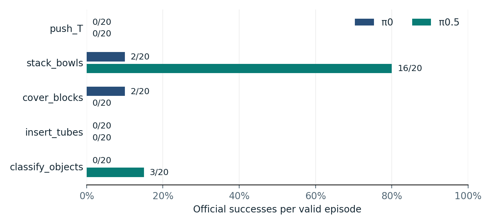
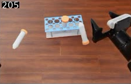
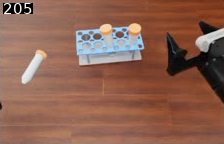
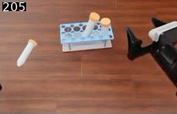

# RoboDojo Policy Evaluation

**A five-task simulation study of π0 and π0.5, with a follow-up test of shorter action execution for tube insertion.**

[中文](README.zh-CN.md) · [Evaluation notes](EVALUATION.md) · [Baseline data](data/baseline.csv) · [Pilot data](data/insertion-pilot.csv)

| Formal baseline | Insertion development | Insertion pilot |
| --- | --- | --- |
| **200** valid episodes across five tasks | **0/3 vs 2/3** on one layout | **0/10 vs 0/10** on five separate layouts |
| π0 scored **4%** and π0.5 scored **19%** on the five-task average. | Executing a shorter prefix looked promising on the development layout. | The gain did not recur. The candidate made more inference calls in every pair. |

## 1. Comparing the official policies

The two official RoboDojo checkpoints controlled a simulated dual-arm ARX X5 using joint actions. Each policy ran 20 episodes per task. The two policies shared the same layout and repeat ID within each of the 100 pairs.

Bowl stacking accounted for most of π0.5's lead. π0 recorded the only two successes on `cover_blocks`. Both policies scored 0/20 on T-block pushing and tube insertion in this batch.

## 2. Looking at what happened during insertion

Both development setups used the same π0.5 checkpoint. The official setup (B09) could execute up to 50 predicted actions per inference call. The candidate (B12) predicted 50 and executed at most 20 on `insert_tubes`, so the next call could use a newer observation. The other four tasks kept their official execution path. B09 was retained after the development comparison, with a five-task average of 43.3% versus 40.0% for B12.

| Official B09 · failed | Candidate B12 · succeeded | Candidate B12 · failed |
| :---: | :---: | :---: |
|  |  |  |

Head-camera frame 205 (8.20 s) from three development episodes on the same layout. Episode outcomes come from the simulator's official check. The frames illustrate placement stability and leave the exact failed condition and the role of feedback unresolved.

## 3. Testing on separate layouts

The follow-up paired the official setup with the full B12 setup on five layouts outside the earlier batches. Each layout ran twice per setup. All 20 episodes reached the 500-step limit and failed the official check. In every pair B12 made 25 inference calls versus 10 for the official setup. Mean elapsed time was **7.52 s longer per pair** for B12, measured from slot claim through result review. The setups also differed in how they ran and exchanged data, so the timing applies to the full setups.

The project retained the official setup. The pilot shows how the candidate behaved on these five layouts and leaves performance on other layouts open. [Read the evaluation notes](EVALUATION.md).

---

**Shiqi Gao** · [GitHub profile](https://github.com/Gary-02-Gao)

Benchmark and policy implementations by the upstream projects. [RoboDojo](https://github.com/RoboDojo-Benchmark/RoboDojo) · [XPolicyLab](https://github.com/XPolicyLab/XPolicyLab)
