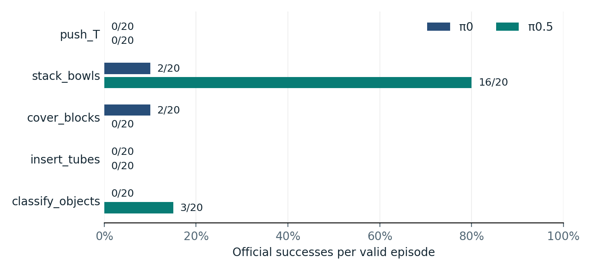
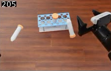
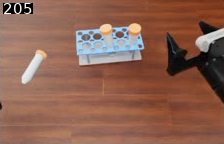
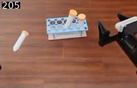

# RoboDojo 机器人策略评估

**在五项仿真操作任务中比较 π0 与 π0.5，并用一轮独立布局试验复核缩短插管动作段的效果。**

[English](README.md) · [评估说明](EVALUATION.md) · [基线数据](data/baseline.csv) · [插管试验数据](data/insertion-pilot.csv)

| 正式基线 | 插管开发试验 | 插管后续试验 |
| --- | --- | --- |
| 五项任务，**200** 个有效回合 | 单个布局，**0/3 对 2/3** | 五个额外布局，**0/10 对 0/10** |
| 五任务平均成功率为 π0 **4%**、π0.5 **19%**。 | 缩短动作段的候选配置在这个布局上成功两次。 | 正向线索没有复现，且候选配置在每对回合中都用了更多推理调用。 |

## 正式基线

两个模型都使用针对 RoboDojo 微调的官方 checkpoint，以关节动作控制仿真的双臂 ARX X5。每个模型在每项任务上完成 20 个有效回合。100 对回合按布局和重复编号配对。

π0.5 的领先主要来自叠碗（16/20 对 2/20）。盖块任务只有 π0 成功过（2/20）。两种配置在推 T 块和插管任务上均为 0/20。

## 插管轨迹与开发选择

开发阶段固定 π0.5 checkpoint。官方配置 B09 单次推理最多执行 50 步。候选配置 B12 在插管任务中同样预测 50 步，但最多执行前 20 步，以便下一次推理更早使用新观测。其余四项任务沿用官方执行路径。五任务平均成功率为 B09 43.3%、B12 40.0%，因此保留 B09。

| 官方 B09 · 失败 | 候选 B12 · 成功 | 候选 B12 · 失败 |
| :---: | :---: | :---: |
|  |  |  |

三张图均为同一开发布局中头部相机的第 205 帧（8.20 秒）。成败以官方判定为准。画面能观察到管的放置状态，具体失败条件及反馈的作用仍待确认。

## 在额外布局上复核

后续试验使用前两批都未使用的五个布局。每种配置在每个布局重复两次，共十对。20 个回合均达到 500 步上限并被判为失败。候选配置每回合调用推理 25 次，官方配置 10 次。从领取评估任务到完成复核，候选配置每对平均多用 **7.52 秒**。两组的运行方式和数据传输也有差异，耗时应按整套配置理解。

这轮试验没有复现单一开发布局上的提升。结论限于本轮的五个布局。实验继续采用官方配置。 [评估说明](EVALUATION.md)

---

**Shiqi Gao** · [GitHub 主页](https://github.com/Gary-02-Gao)

基准与策略实现来自上游项目。 [RoboDojo](https://github.com/RoboDojo-Benchmark/RoboDojo) · [XPolicyLab](https://github.com/XPolicyLab/XPolicyLab)
